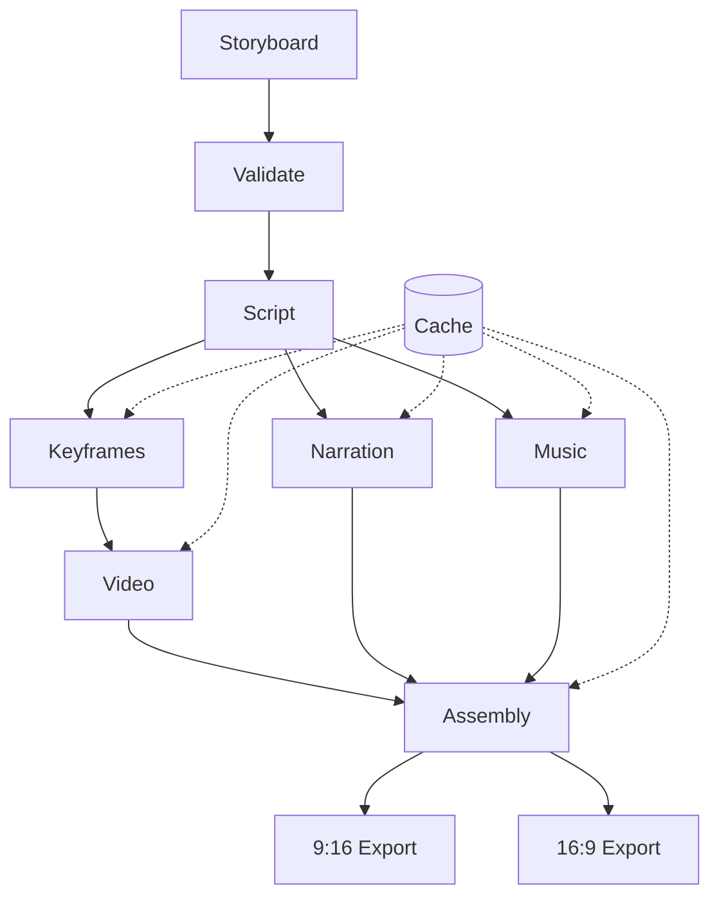

# DESIGN.md

## 1. Overview

Heritage Short is a 60–90 second AI-generated short film celebrating Ethiopian cultural heritage.

The project delivers both the finished film (9:16 and 16:9) and a reproducible pipeline for generating it.

The pipeline uses a validated `storyboard.json` as its shared contract. Each stage reads the storyboard and produces its corresponding assets.

## 2. Design decisions

- **Shared storyboard:** One JSON file describes the film and its shots. A JSON Schema validates it before pipeline execution.
- **Independent shots:** Each shot has its own duration, keyframe prompt, motion prompt, narration line, English subtitle and music cue.
- **Consistent visuals:** A style block and a character description are defined at film level and repeated in every keyframe prompt. The default keyframe model, `flux-2-klein-4b`, also conditions every shot keyframe on an approved character image (`character.reference_image`) and takes a per-shot seed; `flux-1-schnell` has neither. Consistency is tested through user tests and EXPERIMENTS.md, not guaranteed. A generated reference sheet, made only when there is no reference image, is a human golden reference only.
- **Single soundtrack:** One original score is generated for the entire film, from a cue sheet built from the per-shot music cues (`music_cue`) in `storyboard.json`: the film-level music prompt followed by each shot's cue at its start and end time.
- **Reusable assets:** Each output has a fingerprint of its relevant inputs. Unchanged outputs are reused; changed inputs trigger regeneration only where necessary.
- **Shared source footage:** Shots are generated once. Both aspect ratios are produced during final assembly.
- **Incremental development:** Pipeline stages are tested independently before running the complete production.

## 3. Architecture

Each stage is independently executable. Generated assets are preserved in `outputs/`, while `runs.jsonl` records individual model calls, including model, parameters, seed, latency and cost.

If an asset's inputs change, only that asset and its downstream dependencies should be regenerated. Failed generations must not replace previously successful outputs.

### Execution environments

Each stage uses the interface and environment prescribed by the assessment:

| Stage | Interface / environment |
| --- | --- |
| Script | Gemini API |
| Narration | Gemini API (TTS) |
| Keyframes | Cloudflare Workers AI |
| Moving shots | Wan 2.2 on Kaggle or Colab |
| Music | ACE-Step 1.5 on Kaggle or Colab |
| Assembly | Local FFmpeg |

The pipeline calls these hosted APIs and notebooks directly. It does not introduce custom model-serving infrastructure or additional deployment layers.

**Production decision for the assessment film (revised after E6):** moving shots are generated with Wan 2.2 TI2V-5B through Diffusers on Kaggle's two T4s: the video model in float16 on one GPU, the text encoder and the full float16 VAE on the other, at 832×480, 121 frames and 20 steps. The assessment's FFmpeg pan-and-zoom is the fallback for any shot Wan does not deliver usably. The music is the filmmaker's chosen ACE-Step candidate, already generated on Kaggle.

One measured shot took about 10 minutes plus about 5 minutes of setup per GPU session, so a film of 8–12 shots is estimated at roughly 1.4–2.7 hours of GPU time. On that shot the character's face changed in the last second and the 9:16 crop was soft, so every Wan clip is reviewed before use. The pipeline's Wan kernel now implements this setup and has run one shot through the pipeline (`EXPERIMENTS.md` E10); Wan's own command, which cannot run on a T4, is no longer used (`EXPERIMENTS.md`, E4–E6 and "Production decision (revised after E6, 2026-11-26)"; `FAILURES.md` 15 and 27).

**"The Tree That Was Always There" (status 2026-11-26).** The film is a personal childhood memory, told by the filmmaker as an adult. The English narration, the score and the radio cut are complete and approved. **The final film is the FFmpeg version:** the approved keyframes animated with pan-and-zoom for all 11 shots (`EXPERIMENTS.md` E11). A Wan 2.2 version was also generated (all 11 shots, 2 h 2 min, 2.02 GPU hours) and passed every technical check, but hallucinations and identity drift late in s02, s06, s09, s10 and s11 broke the story, so it is kept as an experiment, not the final film (`EXPERIMENTS.md` E12 and "Model selection for the final film"; `FAILURES.md` 37). The FFmpeg film moves less but stays faithful to the approved images, needs no GPU and builds in under a minute. The experimental Wan film is linked from `README.md`, "Production outputs"; it is not the final film. The keyframes are made with FLUX.2 [klein] 4B. Two attempts to make the children's reference image with Klein did not give believable children, so the filmmaker generated the reference with Nano and supplied it; a children-only crop of it is the reference for the five shots that show the children, which keeps their faces, ages and clothing consistent, and the six shots of only the patio, house or tree use no reference and show no people (`EXPERIMENTS.md` E9; `FAILURES.md` 31–36).

**Likeness and consent.** No likeness of a real person is used in the film. The three children are fictional representations generated for the film, not portraits of the filmmaker, his sister or his cousin; no real family member's face or voice was used as a likeness, and the narration uses a prebuilt Gemini TTS voice, not a cloned voice. No consent record is therefore needed, and none is claimed (`ETHICS.md`).

## 4. Development approach

Development begins with a three-shot test storyboard. This is a testing fixture, not a limit on the final film.
Film length is set per storyboard (`target_seconds`); the assessment's 8-12 shots and 60-90 s are checked only
when the storyboard sets `assessment_rules: true`.

Each stage will be implemented and tested separately:

1. Storyboard validation and script.
2. Keyframe generation.
3. Moving-shot generation.
4. Music generation.
5. Narration generation.
6. Video assembly and exports.

The complete film will be produced only after the individual stages have been tested.

The implementation will prioritize the assessment requirements and avoid unnecessary infrastructure or abstractions.

## 5. Audience, intent and user tests

- **Who will watch:** people who remember losing something they had taken for granted as children: a familiar place,
  an everyday object or an ordinary part of their routine. The tree is specific to the filmmaker's childhood; the story
  is about the first experience of losing something that once felt permanent. (Defined by the filmmaker. The
  storyboard's older `brief.audience` text, "A general audience watching a short, personal film.", is unchanged.)
- **Where:** not decided; the brief's delivery formats are a vertical (9:16) post and a horizontal (16:9) film.
- **What they should feel or understand at the end:** impermanence is hard to understand intellectually, especially as a
  child; the film shows how it can first be felt through an ordinary personal loss. It should invite reflection rather
  than state a lesson (`brief.intent`: "Convey the quiet loss of an ordinary place that had become part of a childhood,
  without explaining why the tree was cut.").
- **Why each shot exists:** every shot has a `reason` in `storyboard.json`.

### User test 1: the radio cut (at least three people from the audience)

Narration over a black screen (`python -m pipeline.assemble --radio`).

**Not met.** Feedback on the audio-only cut came from two community members (below), fewer than the three required, and
nothing has been changed because of it yet.

### User test 2: the near-final cut (at least three people)

**Not met.** Feedback on the FFmpeg film and the Wan film came from the same two community members (below), fewer than
the three required, and nothing has been changed because of it yet.

### Informal community feedback (received; pending evaluation)

Three versions were shared with two community members (referred to as A and B) and reviewed by the filmmaker. The
comments below are the filmmaker's summaries, not quotations. The filmmaker's own observations are listed separately and
are not counted as audience feedback. **None of this feedback has led to a change yet.**

**Audio-only cut (the radio cut)**
- Member A: found it good and interesting; at first thought it had been cut off (it had not); said the narration sounded
  natural; liked the background music, which made the story feel like a warm, sunny day; would like to hear an Amharic
  version.
- Member B: suggested giving the story a clearer meaning, such as enjoying things while they last because we may lose
  them; suggested making the tree feel part of the house and patio rather than appearing inconsistently between shots.
- Filmmaker: "Nazreth" was pronounced unusually; there were sometimes long pauses in the narration.

**FFmpeg film**
- Member A: the film looked different from what they had imagined; the tree looked smaller than expected; commented on
  the houses.
- Member B: asked whether the tree could be more consistent; it sometimes seemed absent from the house before appearing
  in the middle of the scene; suggested giving the tree a clearer visual definition.
- Filmmaker: the subtitles matched the narration and the picture; the film relies heavily on zooming and panning, with
  little actual movement.

**Wan film (experimental)**
- Member A: described the video as erratic; it had more movement than the stable version, but parts needed correction;
  suggested a livelier environment and a tree that children could realistically climb; felt the emotional connection to
  the tree could be stronger: viewers need to see how much the children enjoyed climbing it for its loss to feel
  significant; the message itself might not be the problem, but the viewer needs a better sense of what the tree meant
  to them.
- Filmmaker: unrelated people and objects appeared unexpectedly; characters and scenes changed inconsistently, which
  distracted from the story (`EXPERIMENTS.md` E12, `FAILURES.md` 37).

**Implications for the design (proposed, not yet made):**
- **The children's attachment to the tree:** member A says viewers need to see how much the children enjoyed the tree
  for its loss to matter. Shots s05–s07 may need to show that more clearly before the discovery.
- **The tree as one continuous place:** it varies in size and position between keyframes and is sometimes missing from
  the house shots (`FAILURES.md` 38). A single reference for the setting, as the children's crop is for the children,
  is a candidate.
- **Meaning:** B's suggestion of a clearer lesson is noted, but the filmmaker does not want to add an explicit moral
  that would distort the memory; the aim is to let the story invite reflection.
- **The ending:** A's impression that the audio cut had been cut off may relate to the score fading out before the last
  line, leaving the end silent (`EXPERIMENTS.md` E8); not established.
- **Narration:** the pronunciation of "Nazreth" and the long pauses (shot timing leaves 2.0–3.2 s after each line,
  `EXPERIMENTS.md` E7) are candidates for revision.
- **An Amharic version** was requested; it is not part of this submission.
