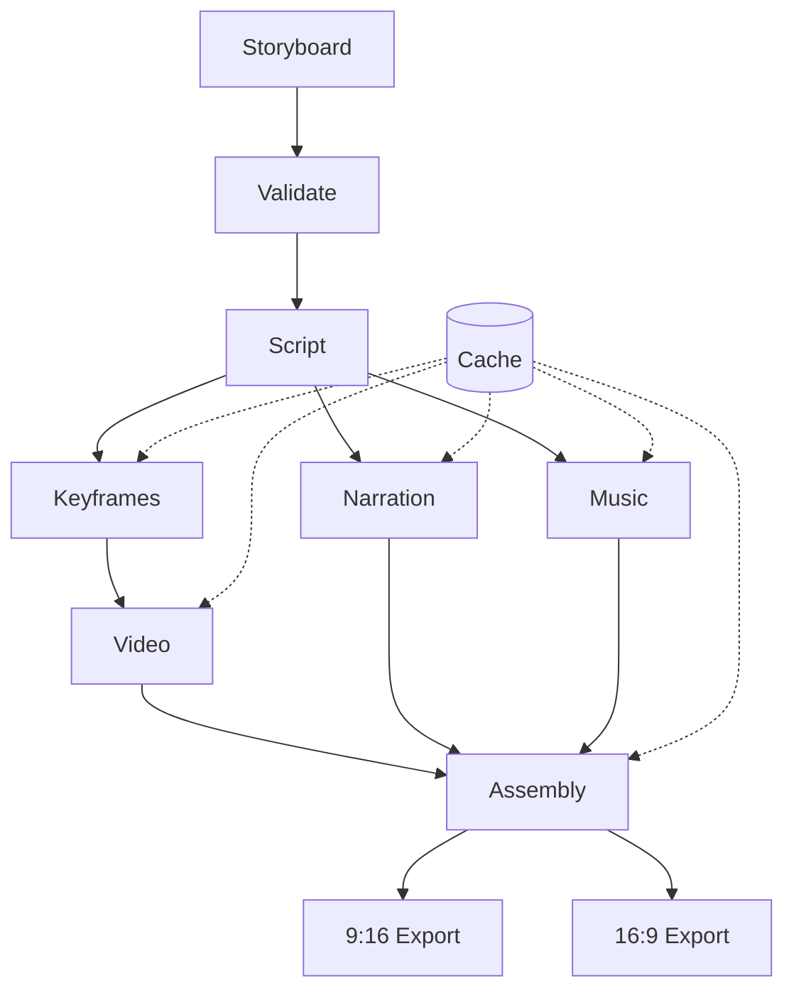

# DESIGN.md

## 1. Overview

Heritage Short is a 60–90 second AI-generated short film celebrating Ethiopian cultural heritage.

The project delivers both the finished film (9:16 and 16:9) and a reproducible pipeline for generating it.

The pipeline uses a validated `storyboard.json` as its shared contract. Each stage reads the storyboard and produces its corresponding assets.

## 2. Design decisions

- **Shared storyboard:** One JSON file describes the film and its shots. A JSON Schema validates it before pipeline execution.
- **Independent shots:** Each shot has its own duration, keyframe prompt, motion prompt, narration line and English subtitle.
- **Consistent visuals:** Character references and visual style instructions are defined at film level and reused across shots.
- **Single soundtrack:** One original music cue is generated for the entire film.
- **Reusable assets:** Each output has a fingerprint of its relevant inputs. Unchanged outputs are reused; changed inputs trigger regeneration only where necessary.
- **Shared source footage:** Shots are generated once. Both aspect ratios are produced during final assembly.
- **Incremental development:** Pipeline stages are tested independently before running the complete production.

## 3. Architecture

Each stage is independently executable. Generated assets are preserved in `outputs/`, while `runs.jsonl` records individual model calls, including model, parameters, seed, latency and cost.

If an asset's inputs change, only that asset and its downstream dependencies should be regenerated. Failed generations must not replace previously successful outputs.

## 4. Development approach

Development begins with a three-shot test storyboard. This is a testing fixture, not a limit on the final film.

Each stage will be implemented and tested separately:

1. Storyboard validation and script.
2. Keyframe generation.
3. Moving-shot generation.
4. Music generation.
5. Narration generation.
6. Video assembly and exports.

The complete film will be produced only after the individual stages have been tested.

The implementation will prioritize the assessment requirements and avoid unnecessary infrastructure or abstractions.# DESIGN
