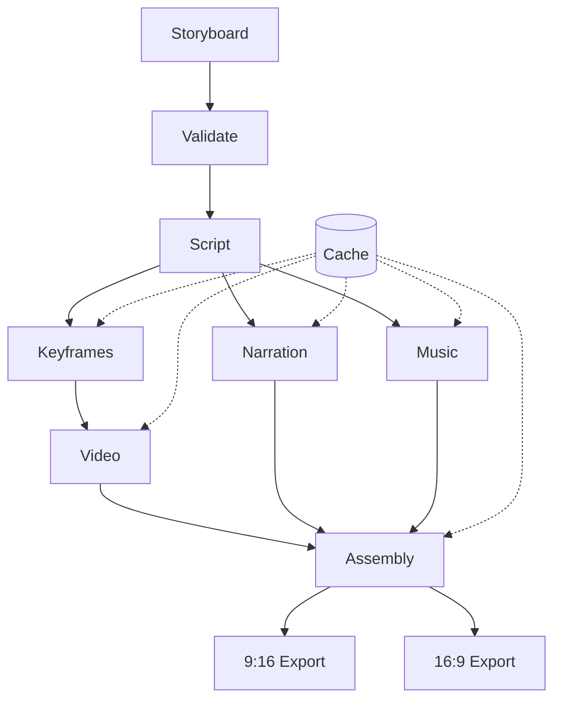

# DESIGN.md

## 1. Overview

Heritage Short is a 60–90 second AI-generated short film celebrating Ethiopian cultural heritage.

The project delivers both the finished film (9:16 and 16:9) and a reproducible pipeline for generating it.

The pipeline uses a validated `storyboard.json` as its shared contract. Each stage reads the storyboard and produces its corresponding assets.

## 2. Design decisions

- **Shared storyboard:** One JSON file describes the film and its shots. A JSON Schema validates it before pipeline execution.
- **Independent shots:** Each shot has its own duration, keyframe prompt, motion prompt, narration line, English subtitle and music cue.
- **Consistent visuals:** A style block and a character description are defined at film level and repeated in every keyframe prompt. The default keyframe model, `flux-2-klein-4b`, also conditions every shot keyframe on an approved character image (`character.reference_image`) and takes a per-shot seed; `flux-1-schnell` has neither. Consistency is tested through user tests and EXPERIMENTS.md, not guaranteed. A generated reference sheet, made only when there is no reference image, is a human golden reference only.
- **Single soundtrack:** One original score is generated for the entire film, from a cue sheet built from the per-shot music cues (`music_cue`) in `storyboard.json`: the film-level music prompt followed by each shot's cue at its start and end time.
- **Reusable assets:** Each output has a fingerprint of its relevant inputs. Unchanged outputs are reused; changed inputs trigger regeneration only where necessary.
- **Shared source footage:** Shots are generated once. Both aspect ratios are produced during final assembly.
- **Incremental development:** Pipeline stages are tested independently before running the complete production.

## 3. Architecture

Each stage is independently executable. Generated assets are preserved in `outputs/`, while `runs.jsonl` records individual model calls, including model, parameters, seed, latency and cost.

If an asset's inputs change, only that asset and its downstream dependencies should be regenerated. Failed generations must not replace previously successful outputs.

### Execution environments

Each stage uses the interface and environment prescribed by the assessment:

| Stage | Interface / environment |
| --- | --- |
| Script | Gemini API |
| Narration | Gemini API (TTS) |
| Keyframes | Cloudflare Workers AI |
| Moving shots | Wan 2.2 on Kaggle or Colab |
| Music | ACE-Step 1.5 on Kaggle or Colab |
| Assembly | Local FFmpeg |

The pipeline calls these hosted APIs and notebooks directly. It does not introduce custom model-serving infrastructure or additional deployment layers.

**Production decision for the assessment film:** moving shots use the assessment's FFmpeg pan-and-zoom fallback, and the music is the filmmaker's chosen ACE-Step candidate already generated on Kaggle. Real Wan 2.2 shots (through Diffusers, not the pipeline's Wan kernel, which cannot run on a T4) and ACE-Step music were both shown to be feasible on a Kaggle T4. But one short Wan clip took a 40-minute GPU session, and every regeneration of either needs a Kaggle account, CLI and quota, and new music needs a new listening choice (`EXPERIMENTS.md`, E4, E5 and "Production decision").

## 4. Development approach

Development begins with a three-shot test storyboard. This is a testing fixture, not a limit on the final film.
Film length is set per storyboard (`target_seconds`); the assessment's 8-12 shots and 60-90 s are checked only
when the storyboard sets `assessment_rules: true`.

Each stage will be implemented and tested separately:

1. Storyboard validation and script.
2. Keyframe generation.
3. Moving-shot generation.
4. Music generation.
5. Narration generation.
6. Video assembly and exports.

The complete film will be produced only after the individual stages have been tested.

The implementation will prioritize the assessment requirements and avoid unnecessary infrastructure or abstractions.

## 5. Audience, intent and user tests

*To be written by the filmmaker before generating anything (assessment: audience and intent first).*

- **Who will watch, and where:**
- **What they should feel or understand at the end:**
- **Why each shot exists:** every shot has a `reason` in `storyboard.json`.

### User test 1: the radio cut (at least three people from the audience)

Narration over a black screen (`python -m pipeline.assemble --radio`).
What they said:
What changed in `storyboard.json` because of it:

### User test 2: the near-final cut (at least three people)

What they said:
What changed because of it:
